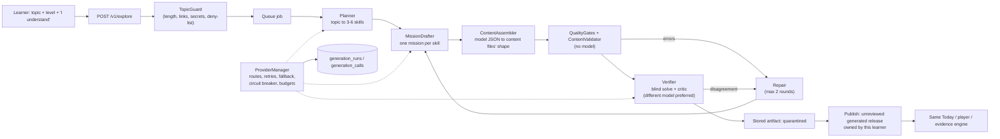

# 16 · Content engine

Status: **Built, switched off by default.** Behind `GENERATION_ENABLED`. Verified offline and against a mock of the Anthropic API;
**not yet run against a real model**, so real-world content quality is unmeasured (§10).

## Purpose

DevStep's authored missions are the product's quality bar, but there are only two of 18 and each takes expert time. This doc covers
a **content engine** that writes practice for any software topic a learner names ("Learn something else"), through any model:
a vendor API, a third party, a local model, or the founder's own service. It covers how content is made, how its quality is held,
what is logged, and what learners are told.

## Summary

- **Decision (founder, recorded):** build a model-agnostic engine that can make a short personal path on a topic the learner chooses. **Decision, built**
- **This is an exception to three earlier rulings, and it is bounded.** `06` §13 allowed no path to a published item without human review; `12` §9 deferred "universal course generation" and R08 excluded "arbitrary AI-generated curricula"; `12` RK05 said "no AI in the MVP". The engine keeps the spirit of all three by making AI content a **separate tier**: visible only to the learner who asked, labelled everywhere it appears, **capped at Practised** in evidence, never counted as reviewed, and promotable only by a named person (§7). Authored content and its rules are unchanged. **Proposal, built; needs the founder's sign-off before it is switched on for learners**
- **One contract, many models.** Every provider implements one small interface. Switching vendor, model or local server is configuration, not code (§3).
- **Quality is enforced by code, not by trusting the model.** A fixed set of deterministic gates, the existing content validator, a blind solve by a second model and a critic's review decide what is kept. Anything that fails after two repair rounds is discarded, not shown (§4).
- **Everything is logged.** Every model call records provider, model, tokens, cost, latency and outcome. Prompts and replies are off by default (§6).
- **Nothing the learner already has is touched** until they press Start, and a started path sits beside their main roadmap, with both kept (§8).
- **No model is ever the reviewer.** `generation:review` needs a named person who tried the exercise (`06` §13).

## 1. Scope and boundaries

| In this doc | Owned elsewhere |
| --- | --- |
| The engine: providers, routing, pipeline, gates, logging | Content format, validator rules, publisher: `06` |
| Personal paths: request, ownership, labels, review, deletion | Evidence levels and the cap's place in them: `05` §6 |
| Learner-facing wording and controls | Step's voice and the guilt-free rules: `15` |
| Privacy rules this feature relies on | The controls it must meet: `09` §3.7, C59–C62 |

## 2. Architecture



Code lives in `app/Modules/Generation` (engine) with the queue jobs in `app/Jobs`, the HTTP layer in `ExploreController`, and commands
`generation:providers`, `generation:draft`, `generation:runs`, `generation:review`, `generation:backfill`.

## 3. Providers: any model, no code changes

### 3.1 The contract

`LlmProvider` (`id`, `model`, `price`, `problem`, `complete`). `complete` takes one vendor-neutral `LlmRequest` (task, system prompt,
messages, optional JSON Schema, token cap) and returns an `LlmResponse` (text, parsed JSON, tokens, latency) or throws one
`LlmException` whose `kind` is one of: `rate_limit`, `timeout`, `network`, `server`, `auth`, `bad_request`, `refusal`, `truncated`,
`invalid_output`, `unavailable`. Nothing outside a provider knows a vendor's API or exception types.

### 3.2 Drivers

| Driver | Reaches | Notes |
| --- | --- | --- |
| `anthropic` | Claude, through the **official PHP SDK** | Structured output via `output_config`; `effort` per provider; sampling parameters are never sent (current Claude models reject them); the SDK's own retries are off so behaviour matches every other provider. |
| `openai_compatible` | OpenAI, Azure OpenAI, OpenRouter, Groq, Together, Mistral, **and local servers** (Ollama, vLLM, LM Studio, llama.cpp) | `json_mode`: `schema` (strict structured output), `object` (JSON mode, schema in the prompt), `none` (parsed from text). Handles reasoning-model `<think>` blocks, content parts, Azure query strings and headers, no API key for local. |
| `http` | **Anything else**: an in-house gateway, a model behind custom code | A fixed JSON contract (§3.4). |
| `fake` | Nothing: deterministic offline content | Tests and demos. **Refuses to run in production.** |

### 3.3 Configuration

Providers are named entries in `config/generation.php`. **Routes** say which providers handle each task, in order; the first healthy
one answers and the rest are fallbacks:

```env
# Claude drafts, a second Claude model checks, a local model is the fallback for both
GENERATION_ENABLED=true
GENERATION_ROUTE_PLAN=anthropic,local
GENERATION_ROUTE_DRAFT=anthropic,local
GENERATION_ROUTE_VERIFY=anthropic_fast,local
ANTHROPIC_API_KEY=...
GENERATION_LOCAL_URL=http://127.0.0.1:11434/v1
GENERATION_LOCAL_MODEL=llama3.1
```

```env
# Fully local, nothing leaves the machine
GENERATION_ROUTE_PLAN=local
GENERATION_ROUTE_DRAFT=local
GENERATION_ROUTE_VERIFY=local
GENERATION_REQUIRE_INDEPENDENT_VERIFIER=false   # one model: weaker checking, see §5
```

`php artisan generation:providers` shows each provider, whether it is ready, why not, and its routes; `--ping` sends one tiny request to
every ready provider. Adding a vendor with a new wire format means one new driver class and one line in `ProviderFactory`.

### 3.4 The custom endpoint contract

We POST `{"task","system","messages":[{"role","content"}],"schema":{...}|null,"schema_name","temperature","max_tokens"}`. We expect
`{"text":"..."|"json":{...}, "model", "usage":{"input_tokens","output_tokens"}, "finish_reason"}`. Either `text` or `json` is enough;
`429` and `5xx` are retried.

### 3.5 Resilience

Per call: providers are tried in route order. A provider is **retried** (with backoff and `Retry-After`) on rate limits, timeouts, network
and server errors. A reply that does not fit the expected shape is **retried with the problems quoted back**. Anything else moves to the
next provider. A provider that fails three times in a row is **skipped for 60 seconds** (circuit breaker). If every provider fails, the run
fails with a calm message and changes nothing. **Budgets are hard stops**: USD per run, USD per day, runs per learner per day (§6).

## 4. The pipeline and its gates

1. **Guard.** The topic is normalised and refused, before any model sees it, if it is too short or long, has links or markup, looks like an email or key, is mostly symbols, or matches the deny-list (building malware, bypassing licences, self-harm). A refusal creates no run and costs nothing.
2. **Plan.** The model returns an outline: 3–6 skills, each with an objective ("Given …, choose …"), prerequisites (a DAG), and common misconceptions. It may also refuse as out of scope; its one-sentence reason is shown to the learner.
3. **Draft.** One mission per skill: teaching scenario, worked example, six items (primary ×2, changed-condition, topic check, two alternates, one of them a self-check) with feedback for every wrong option, graduated hints and a reveal. The prompt's rule is that **every question must be answerable from the scenario and the worked example**, not from trivia: that is what makes it checkable.
4. **Assemble.** The model returns JSON; **the engine, not the model, writes front matter, IDs, steps, held-back lists and flags**, in exactly the shape `ContentLoader` reads from files. Structure cannot drift whichever model is behind it.
5. **Gates (no model).** The existing `ContentValidator` (with `allow_unsourced` and `allow_unreviewed`, because generated content has no sources and no reviewer) plus:

| Code | Rule |
| --- | --- |
| Q01 | No raw HTML or markup |
| Q02 | No links of any kind (it cannot cite a source a person has opened) |
| Q03 | No secrets, keys, emails or phone numbers |
| Q04 | No pressure, guilt, streak or comparison wording; no exclamation marks or emoji (same words as Step's unit test) |
| Q05 | Size limits; 1–3 hints per item; no oversized code blocks |
| Q06 | 3–5 distinct options; no "all/none of the above"; every wrong option has real feedback |
| Q07 | The correct option is not the longest in most items (the answer cannot be guessed by length) |
| Q08 | Held-back items are a genuinely different situation from the teaching scenario and from each other |
| Q09 | A hint may not repeat the correct option |
| Q10 | No destructive commands a learner might copy |
| Q11 | Absolute claims ("always", "never") are flagged as warnings |
| Q13 | No duplicate prompts |

6. **Verify (a second opinion).** Preferably a different model: (a) a **blind solve**: it takes every auto-scored item with no key and no feedback; any disagreement with the key, or any "ambiguous" or low-confidence answer, is a blocker; (b) a **critic** reads the whole mission with its key and lists factual problems, giveaway hints and unfair items, and anything it cannot vouch for.
7. **Repair or reject.** Blockers go back to the drafter with the exact problems, at most **two** repair rounds. Anything still failing is **discarded**: the learner is told nothing was kept. When `require_independent_verifier` is on (the production default) content is only kept if the verifier is a different (provider, model) pair.
8. **Store.** Accepted content is stored as a **quarantined** artifact with its warnings, the verifier's answers and notes, who wrote and who checked it, the prompt version and the repair count.

## 5. What this proves, and what it does not

The gates make content **structurally sound, safe to display, calm in tone, and internally consistent**. The blind solve shows a second model reaches the author's answers, so most mis-keyed or ambiguous items are caught. That is **evidence, not proof of truth**: two models can share a mistake, and a confident wrong claim in a scenario can pass. This is why generated content is labelled to the learner, capped in evidence, never counted as reviewed, kept to reasoning from what the scenario shows (no trivia, no versions, no commands to memorise), and reviewable by a person (§7). Do not describe it as verified knowledge.

## 6. Logging, privacy and cost

| Table | Holds | Retention |
| --- | --- | --- |
| `generation_runs` | One row per path (kind `roadmap`) and per mission (kind `mission`, with a parent): status, stage, reason code, repair rounds, whether the verifier was independent, tokens, cost, prompt version, the consent wording acknowledged, **and the topic text** | Rows kept for cost and quality; **the topic text and parameters are erased when the account is deleted** |
| `generation_calls` | One row per model call, including failures: provider, model, attempt, outcome, error kind and a trimmed message, latency, tokens, cost, request hash | Kept |
| `generation_calls.payload` | The prompt and raw reply, **only when `GENERATION_LOG_PAYLOADS=true`** | 30 days, then dropped by `housekeeping:purge` |
| `generated_artifacts` | The content itself and why it was kept; review status | A learner's artifacts are deleted with their account |

- **Analytics never carry the topic.** The four events (`explore_requested`, `explore_ready`, `explore_failed`, `explore_started`) allow only bounded enums and numbers (`10` registry rules).
- **What a provider receives:** the topic, the level, and fixed instructions. Never another learner's data, the learner's email or name, their answers, evidence or progress.
- **Disclosure and opt-in (`09` C59):** the form states plainly that a computer writes the practice, that it is not reviewed, that evidence is capped, and that the typed words go to an AI service. The learner must tick "I understand" and the API refuses without it; the wording version is recorded on the run.
- **Cost:** `generation:runs` shows spend per run and in the last 24 hours. Caps: `GENERATION_RUN_BUDGET_USD` (default 3), `GENERATION_DAILY_BUDGET_USD` (50), `GENERATION_USER_DAILY_RUNS` (3), plus 10 requests an hour per learner. **Typical cost per path is not yet measured** (§10).

## 7. The AI-content tier

| Rule | How |
| --- | --- |
| Only the requester can see or use it | `roadmaps.owner_user_id`; the public catalogue and `GET /roadmaps/{slug}` exclude owned roadmaps; enrolment checks ownership. Another learner gets the same "not found". |
| It says what it is, everywhere | Explore ("Made for you, not reviewed yet"), the Roadmap page, a notice in the player, and the Evidence limitation "From AI-made practice a person has not reviewed". |
| Evidence is capped | `EvidenceService` caps any attempt on a release with `origin = generated, review_status = unreviewed` at **`practised`** (`unreviewed_evidence_cap`) and adds the limitation. Progress and topic completion still work; levels never drop, and evidence already written stays as it was after a later approval. |
| It is never "reviewed" because a model said so | `generation:review --approve` needs `--reviewer` naming a person (a model name is refused) and `--tried-exercise`. A release is reviewed once every mission in it is; a path is shown as reviewed only when all its missions are. |
| It can be taken back | `generation:review --reject` retires the mission (`content_versions.status = retired`); no new session uses it, sessions already planned keep their exact version, and the topic goes back to "being prepared". |
| It leaves with the learner | Deleting an account removes the learner's paths, missions, items and skills from the shared catalogue, their artifacts, and the text they typed. Other learners' content and authored content are untouched. |

## 8. Dynamic focus: more than one path

A learner may hold several paths with **exactly one in focus** (a database rule: one `active` enrolment per learner; a roadmap cannot be held twice). Starting a personal path **parks** the one in focus: progress, drafts and an open session's draft are kept, and the open session is set aside. **Reviews belong to the learner, not to a path**, so parking suspends and moves nothing and reviews from every path keep appearing (an explicit "Pause roadmap" still suspends and shifts them, as before; starting or switching after one brings them back shifted by the days away, with no debt). "Your paths" on the Explore screen switches focus either way. A learner who already holds a path is not enrolled twice.

The path becomes available as soon as the plan and the first mission pass; the other missions are written by separate queue jobs and appear as they are accepted ("Content opening soon" until then). A topic that cannot be made is retried by `generation:backfill` (hourly, one topic per path per pass, 30 minutes apart, **three tries in all**) and then left alone.

## 9. Operations

- **Switch on:** set `GENERATION_ENABLED=true`, configure at least one real provider and route, run `php artisan generation:providers --ping`. `GET /v1/me` then reports `features.explore` and the app shows an Explore tab. **Switch off:** unset it; learners keep any path they started, and nothing new can be made.
- **A queue worker must be running** (`php artisan queue:work`) and the scheduler (`schedule:run`): path generation is a queued job, and `generation:backfill` and the payload purge are scheduled. With `QUEUE_CONNECTION=sync` (development, tests) requests wait for the whole job.
- **Try a provider or prompt change safely:** `php artisan generation:draft "topic" --enable --missions=2` prints what was kept, what was not and why, and publishes nothing. Bump `prompt_version` when a prompt changes.
- **Review queue:** `php artisan generation:review --list`, then `--approve` or `--reject`.
- **Provider outage:** learners see a calm "could not create that path, nothing was changed"; authored content is unaffected. A failing provider is skipped for a minute at a time.
- **A report of bad content:** `generation:review {artifact} --reject --notes=...` retires it.

## 10. Open questions and what has not been verified

1. **Real-model quality is unmeasured.** The engine was tested end to end with the offline provider, and the Anthropic driver against a mock of the API (wire format, headers, structured output, errors), but never against a live model: no key was available. *Recommended:* before enabling for learners, run `generation:draft` on about 30 topics (some deliberately hard or ambiguous), have a person score each mission, and record the keep-rate, repair rate and error rate here. Do the same for each model you plan to route to; local models need `json_mode` tuned and will fail the gates more often.
2. **Cost per path is unknown.** Estimate from `generation:runs` after the first batch; set the caps from it.
3. **Founder sign-off on the exception in the Summary.** Until given, leave it off.
4. **Pilot contamination.** Explore changes what pilot learners practise and how their evidence reads. *Recommended:* keep it off for the pilot cohort, or analyse Explore events separately (`10`).
5. **Vendor terms and the DPA.** The vendor's terms must exclude training on our data and keep retention minimal (`09` §3.7); record the processor in `09` §6.6 before enabling. Anthropic's terms are not asserted here.
6. **Who reviews.** Promotion needs a person; with one part-time reviewer the queue will grow faster than review. *Recommended:* review only paths that several learners start.
7. **Sharing.** A generated path is private. *Not built:* reusing an accepted path for the next learner who asks the same thing, which would save cost but changes the privacy and review story.
8. **Topic and language scope.** English, software topics only; the deny-list is short and deliberately simple.
9. **Prompt injection.** The topic is passed as data and instructed to be ignored as instructions, and output is gated and rendered through the sanitiser with no tools, so the worst case is poor content that fails the gates. A red-team pass is still owed.

## PRD traceability

| PRD | Where |
| --- | --- |
| §6 no guilt, no streaks, no comparison | Gate Q04 uses Step's forbidden words; the engine writes no progress language |
| §7 out of MVP: universal course generation | This doc, as a recorded, flagged exception (Summary) |
| §8 reviewer tries the exercise | `generation:review` (§7) |
| §11, §12 no secrets, no learner data, AI disclosed and opt-in, an AI outage must not block learning | §6, `09` §3.7 mapping below |
| §14 cost discipline | Budgets (§3.5, §6) |

| `09` control | How it is met |
| --- | --- |
| C59 off by default; disclosure and opt-in; DPA | Off by default; the "I understand" box; the DPA is open (§10.5) |
| C60 bounded stateless context, nothing from other learners, no shared cache on learner text, no tools, no writes to evidence | Prompts hold only the topic and level; no cache; the model has no tools; evidence is written only from a learner's own attempts |
| C61 secret redaction; output sanitised; authored fallback | `TopicGuard` refuses secrets; gates Q01–Q03; markdown is rendered with `html: false`; authored content is unaffected by an outage |
| C62 quotas, cap, token limit, kill switch, redacted cost logging | Per-learner and global budgets, per-call token caps, `GENERATION_ENABLED`, the circuit breaker; payloads off by default |
